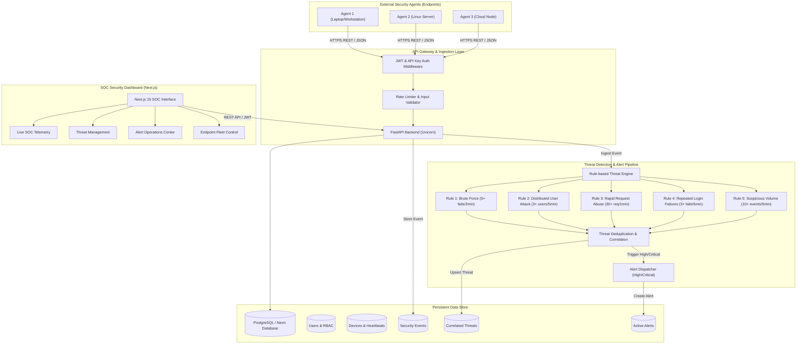

# WATCHGRID — Architecture Specification

## 1. System Architecture Overview

WATCHGRID is a distributed cybersecurity monitoring, telemetry ingestion, and automated threat detection system designed for enterprise security operations centers (SOC) and distributed endpoint fleets.

---

## 2. Component Breakdown

### 2.1 Security Agent (`agent/agent.py`)
- Standalone Python daemon or CLI tool.
- Non-invasive diagnostic telemetry: retrieves hostname, local IP, OS metadata, platform info, and runtime stats using standard libraries (`socket`, `platform`, `psutil`, `requests`).
- Dispatches secure heartbeats periodically (`PATCH /api/devices/{device_id}/heartbeat`).
- Simulates realistic security events and attack vectors (Brute-force, Distributed User Attack, Rapid Request Storm) for academic validation and defense readiness testing.

### 2.2 Ingestion & API Layer (`backend/main.py`)
- Built with **FastAPI** on asynchronous ASGI (`uvicorn`).
- Enforces strict Pydantic schemas, parameter validation, and rate-limiting on authentication routes.
- Dual-mode authentication:
  1. **JWT (Bearer tokens)** for Dashboard users with Role-Based Access Control (Admin, Analyst, Viewer).
  2. **API Keys / Device IDs** for Agent ingestion and heartbeat pings.

### 2.3 Threat Detection Engine (`backend/security/`)
- Real-time event correlation engine executing immediately upon event insertion.
- Evaluates rolling sliding windows per `source_ip` / `target_username`.
- Intelligent deduplication: if an active threat is identified for a given IP and attack pattern, it increments `event_count`, recalculates `confidence`, and refreshes `last_seen` timestamp rather than saturating logs with duplicates.
- Severity classification: `INFO`, `LOW`, `MEDIUM`, `HIGH`, `CRITICAL`.

### 2.4 Alert Pipeline (`backend/services/alert_service.py`)
- Automatically dispatches high-priority Alert records when `HIGH` or `CRITICAL` threats are detected.
- Supports lifecycle states: `NEW` ➔ `ACKNOWLEDGED` ➔ `RESOLVED`.

### 2.5 SOC Dashboard (`frontend/`)
- Next.js App Router, TypeScript, Tailwind CSS, and Recharts.
- Dark SOC aesthetic optimized for Security Operation Center operators.
- Granular pages for Dashboard KPIs, Event Log Stream, Threat Detection Matrix, Alert Management, Fleet Devices, and System Configuration.
